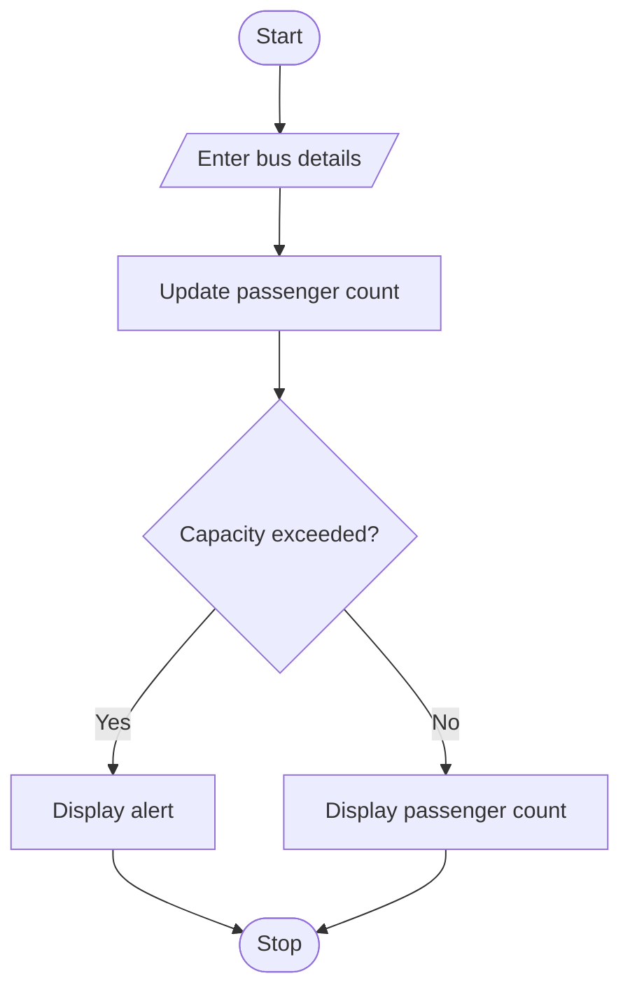

# Bus Passenger Occupancy Simulation 
## 1. Problem Statement

Write a Python program to track the number of passengers on a bus at each stop. The program checks whether the passenger count exceeds the bus capacity.

## 2. Algorithm

1. Start.
2. Enter bus capacity and number of stops.
3. Set passengers to zero.
4. For each stop, enter passengers boarded and passengers left.
5. Update the passenger count.
6. Check whether capacity is exceeded and display the result.
7. Stop.

## 3. Flowchart



## 4. Sample Input

```
Enter bus capacity: 50
Enter number of stops: 2
Passengers boarded: 30
Passengers left: 0
Passengers boarded: 25
Passengers left: 5
```

## 5. Sample Output

```
Current passengers: 30
Capacity exceeded!
```
