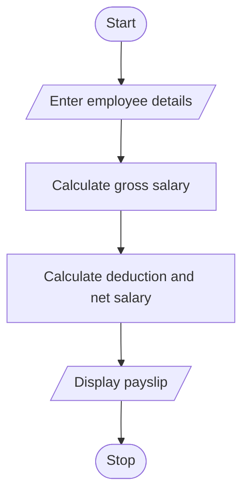

# Employee Payroll and Deduction Analysis
## 1. Problem Statement

Write a Python program to calculate an employee's gross salary, deduction, and net salary based on basic pay, allowances, overtime pay, and incentives. The deduction percentage depends on the gross salary.

## 2. Algorithm

1. Start.
2. Enter employee details and salary components.
3. Calculate gross salary.
4. Calculate deduction based on gross salary:
   - Up to ₹20,000: 5%
   - Up to ₹40,000: 10%
   - Above ₹40,000: 15%
5. Calculate net salary.
6. Display the employee payslip.
7. Stop.

## 3. Flowchart

## 4. Sample Input

```
Enter Employee ID: 101
Enter Basic Pay: 25000
Enter Allowances: 5000
Enter Overtime Pay: 2000
Enter Incentives: 3000
```

## 5. Sample Output

```
-------------------EMPLOYEE PAYSLIP---------------------
Basic Pay     : ₹25000.00
Allowances    : ₹5000.00
Overtime Pay  : ₹2000.00
Incentives    : ₹3000.00
------------------------------
Gross Salary  : ₹35000.00
Deduction     : ₹3500.00
------------------------------
Net Salary    : ₹31500.00
```
