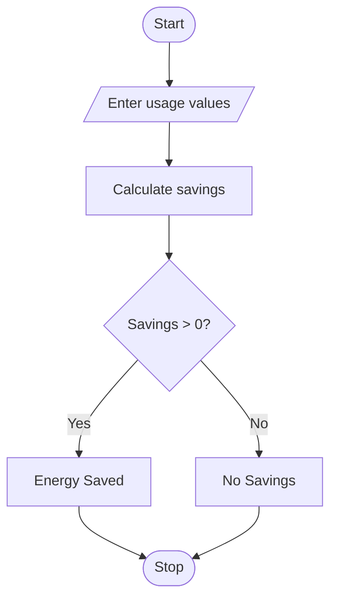

# Energy Conservation Before-and-After Analysis
## 1. Problem Statement

Write a Python program to calculate energy savings by comparing previous and current energy usage. If the savings are greater than zero, display the energy saved; otherwise, display No Energy Savings.

## 2. Algorithm

1. Start.
2. Enter previous and current usage.
3. Calculate savings.
4. Check whether savings are greater than zero.
5. Display the result.
6. Stop.

## 3. Flowchart



## 4. Sample Input

```
Enter previous usage: 500
Enter current usage: 350
```

## 5. Sample Output

```
Energy Saved = 150
```
