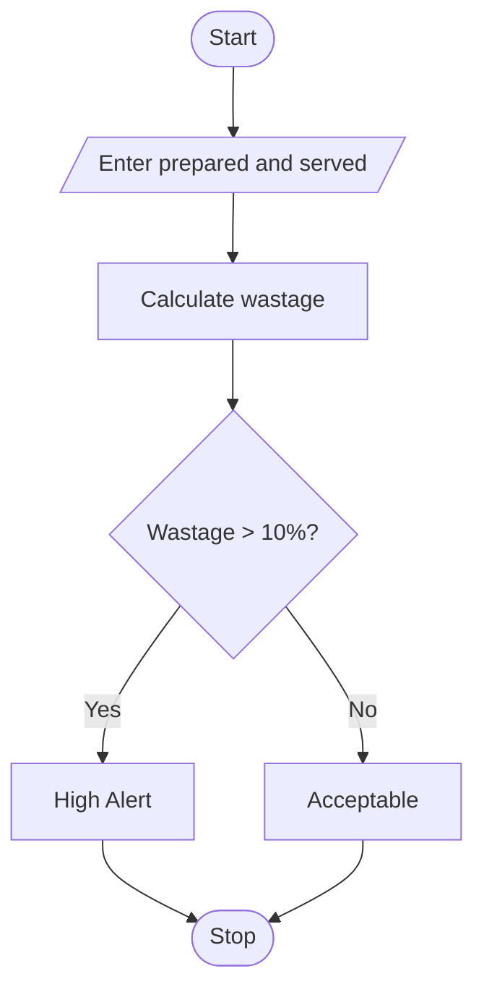

# Food Waste Monitoring System
## 1. Problem Statement

Write a Python program to calculate food wastage. If the wastage percentage is greater than 10%, display a High Wastage Alert; otherwise, display Wastage Within Acceptable Limits.

## 2. Algorithm

1. Start.
2. Enter food prepared and plates served.
3. Calculate wastage.
4. Calculate wastage percentage.
5. Check whether wastage is greater than 10%.
6. Display the result.
7. Stop.

## 3. Flowchart


## 4. Sample Input

```
Enter the amount of food prepared: 100
Enter the number of plates served: 85
```

## 5. Sample Output

```
High Wastage Alert!!!!
```
