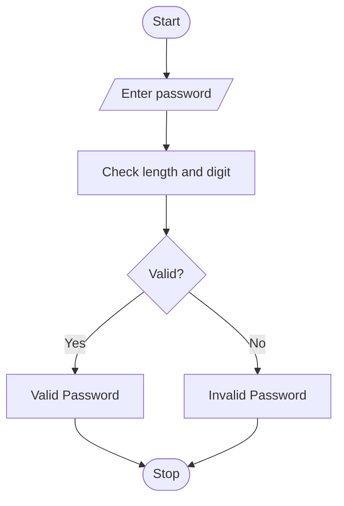

# Password Policy Validation Engine
## 1. Problem Statement

Write a Python program to validate a password. The password must contain at least 8 characters and at least one digit to be considered valid.

## 2. Algorithm

1. Start.
2. Enter the password.
3. Check whether its length is at least 8.
4. Check whether it contains a digit.
5. Display Valid Password if both conditions are true; otherwise, display Invalid Password.
6. Stop.

## 3. Flowchart



## 4. Sample Input

```
Enter password: hello123
```

## 5. Sample Output

```
Valid Password
```
