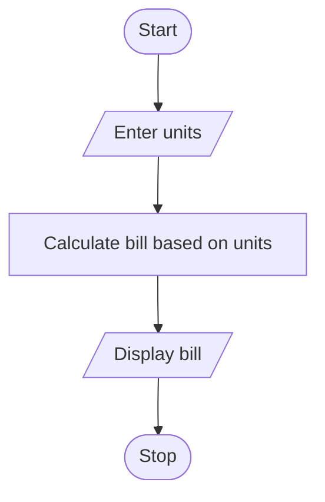

# Progressive Electricity Billing
## 1. Problem Statement

Write a Python program to calculate an electricity bill based on the number of units consumed. The charges are ₹1.5 per unit for the first 100 units, ₹2.5 for the next 100 units, and ₹4 for units above 200.

## 2. Algorithm

1. Start.
2. Enter the number of units.
3. Calculate the bill based on the unit range.
4. Display the bill.
5. Stop.

## 3. Flowchart



## 4. Sample Input

```
Enter units: 250
```

## 5. Sample Output

```
Bill = 450.0
```
