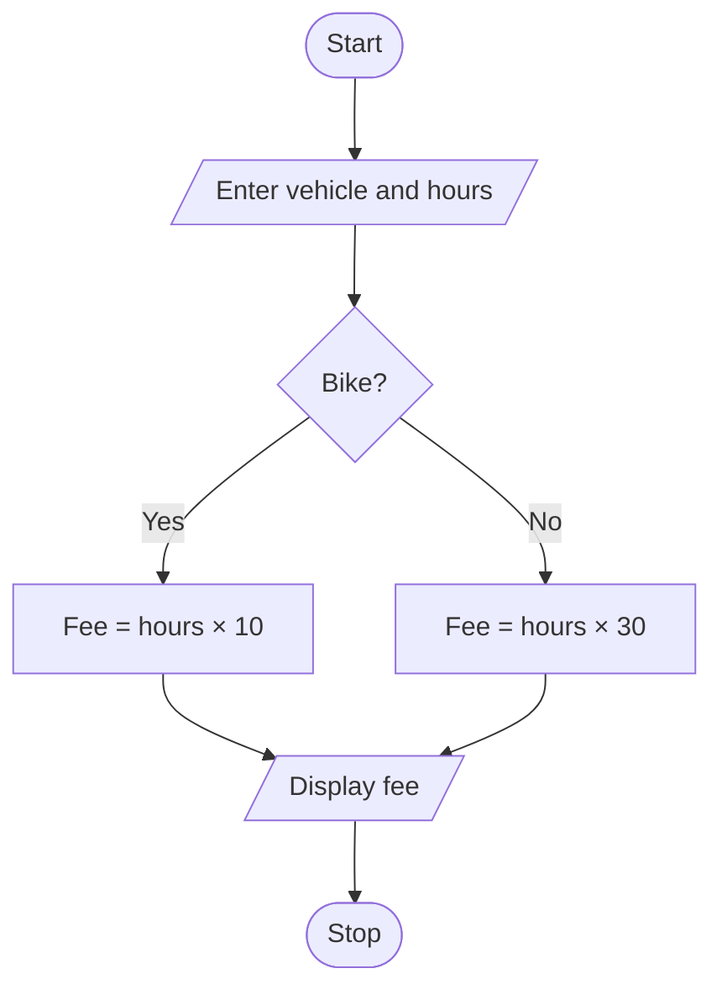

# Smart Parking Fee Management

## 1. Problem Statement

Write a Python program to calculate the parking fee based on vehicle type and parking hours. Bikes are charged ₹10 per hour, while other vehicles are charged ₹30 per hour.

## 2. Algorithm

1. Start.
2. Get vehicle type and parking hours.
3. If the vehicle is a bike, calculate fee as hours × 10.
4. Otherwise, calculate fee as hours × 30.
5. Display the parking fee.
6. Stop.

## 3. Flowchart



## 4. Sample Input

```
Enter vehicle type: bike
Enter hours: 3
```

## 5. Sample Output

```
Parking Fee = 30
```
