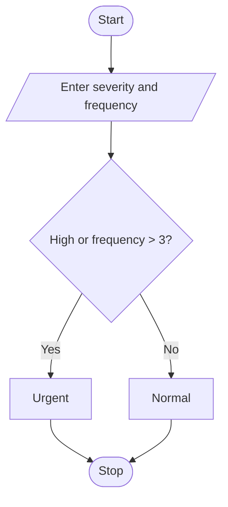

# Smart Campus Incident and Maintenance Prioritization
## 1. Problem Statement

Write a Python program to determine the priority level based on severity and frequency. If severity is "High" or frequency is greater than 3, the priority is Urgent; otherwise, it is Normal.

## 2. Algorithm

1. Start.
2. Enter severity and frequency.
3. Check if severity is High or frequency is greater than 3.
4. Display Urgent or Normal priority.
5. Stop.

## 3. Flowchart


## 4. Sample Input

```
Enter severity: High
Enter frequency: 2
```

## 5. Sample Output

```
Priority: Urgent
```
