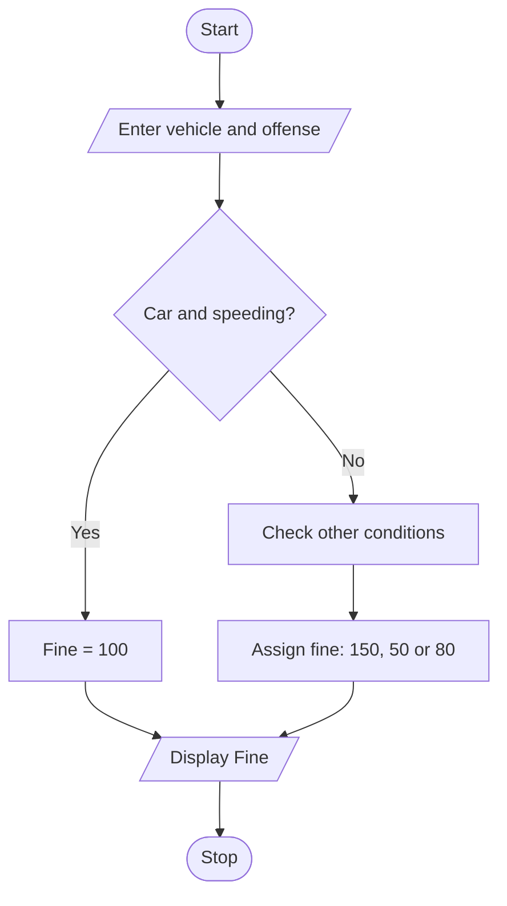

# Traffic Violation Penalty Calculator

### 1. Problem Statement

Write a Python program to calculate the traffic violation fine based on the vehicle type and offense committed. If the vehicle is a car, the fine is ₹100 for speeding and ₹150 for other offenses. For other vehicles, the fine is ₹50 for speeding and ₹80 for other offenses.

### 2. Algorithm

1. Start.
2. Get vehicle type from the user.
3. Get offense from the user.
4. Check whether the vehicle is a car.
5. If it is a car:
   - If speeding, fine = ₹100.
   - Otherwise, fine = ₹150.
6. If it is not a car:
   - If speeding, fine = ₹50.
   - Otherwise, fine = ₹80.
7. Display the fine amount.
8. Stop.

### 3.Flowchart

### 4. Sample Input

```
Enter vehicle type: car
Enter offense: speeding
```

### 5. Sample Output
```
Fine = 100
```
